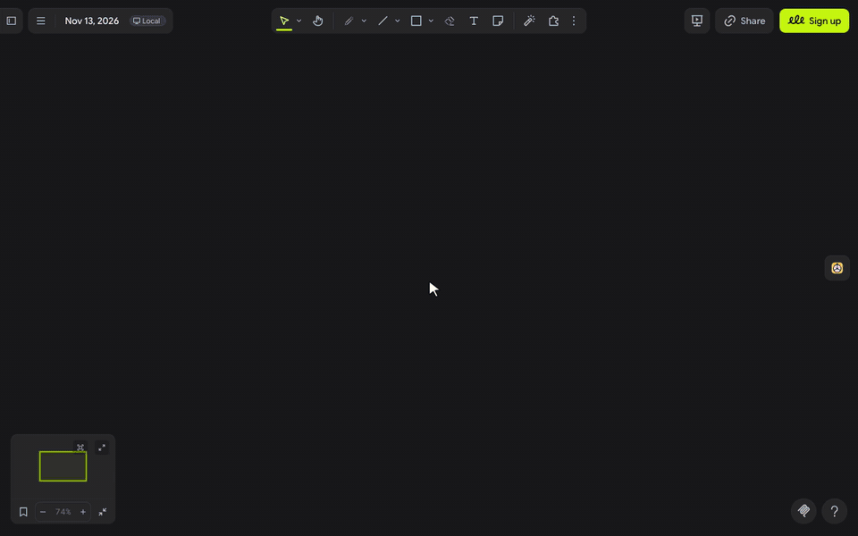

# Spin (ﾉ◕ヮ◕)ﾉ\*:･ﾟ✧

**who's next? let the wheel decide.**

Spin is a picker wheel, dice, a coin, a group splitter and warm-up questions for your board. Press Spin and everyone on the board watches the same wheel turn and land on the same answer, which stays behind as a sticky ✧

---

## let's spin ٩(◕‿◕)۶

1. Click the **wheel** in the extension rail.
2. Pick a mode: **Wheel**, **Order**, **Groups**, **Dice**, **Coin** or **Warm-up**.
3. For the wheel, an order or groups, choose who to pick from: **People here**, the **Stickies** you select on the board, or a **List** you type, one per line.
4. Press **Spin**. Everyone on the board sees it turn and land together, and the result stays as a sticky near the middle of your view.

> (・_・;) **Only you on the wheel?** **People here** lists who has the board open right now. Ask everyone to open the board, or switch to **List** and type the names.

---

## make it yours (｡•̀ᴗ-)✧

- **Groups**: choose a number of groups or a group size; no group ever has more than one person more than another.
- **Dice**: one to three dice, with 6 or 20 sides.
- **Warm-up**: 120 questions written for teams, 60 in English and 60 in Thai, and Spin skips the ones you drew lately.
- **Remove winner**: after a wheel spin over stickies or a list, take the winner out before the next spin.
- **Tick sound**: a soft tick as each peg passes the pointer, heard only by you.

---

## little things to try (っ˘ω˘ς )

- Start standup with **Order** over **People here**, so nobody has to volunteer.
- Select the stickies from a brainstorm and let the wheel pick the next one to discuss; Spin selects it and takes you there.
- Split a workshop into groups of 4 and drop each group card beside its breakout frame.
- Open a retro with a **Warm-up** question in **ไทย** for the Bangkok team.

---

**the small print**: the panel loads its font from jsDelivr and Spin fetches nothing else. When you press Spin, your browser picks the result and puts it on the board as a sticky that carries the names and the result, so other screens can replay the spin; on a cloud board it syncs with the board like any sticky. **People here** reads the names of who has the board open, only while you use it. Your settings and typed list are saved in this browser. The warm-up questions were written for Spin. Code [MIT](https://github.com/mickyngub/drawdy-spin/blob/main/LICENSE); building it yourself? See [DEVELOPMENT.md](https://github.com/mickyngub/drawdy-spin/blob/main/DEVELOPMENT.md).
